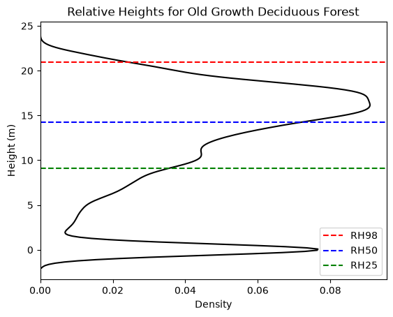

# Seeing the Trees for the Forest:
# A Streamlit-based Application for Visualizing Forest Structure with LiDAR

An interactive Streamlit application for exploring three-dimensional forest structure using airborne light detection and ranging (LiDAR) data. 

This application allows users to visualize LiDAR point clouds and compare relative height metrics across three distinct forest types.

Access the web version here: https://forestlidar.streamlit.app/

# Background
Forest structure is a fundamental characteristic of plant communities and plays an essential role in ecosystem structure (Ehbrecht et al., 2021; Gamfeldt et al., 2012). Forest structure primarily refers to the three-dimensional (3-D) arrangement of vegetation in a forest, extending from the forest floor to the top of the canopy (Oliver and Larson, 1996). Light detection and ranging (LiDAR) technologies provide a powerful tool for retrieving forest structure measurements across multiple dimensions (Coops et al., 2021). There are many different approaches for estimating forest structure from LiDAR, but for this app we focus on relative height (RHn), as it is applicable to both spaceborne and airborne platforms. RHn are defined as the distance between the elevations of detected ground return and the n% accumulated waveform energy, where n ranges from 1 to 100 (Duncanson et al., 2020), and have demonstrated relation to biomass and canopy volume (Lefsky 2002; Lim et al., 2003).




# Repository Structure
```
weblidar-forest-structure/
├── README.md
├── app.py
├── assets/
    └── app-demo.gif
├── requirements.txt      
├── data/                 
├── notebooks/            
    └── analysis.ipynb
    └── preprocessing.R
└── figures/              
```
# Getting Started
clone the repository:
```
git clone https://github.com/rgizzo/weblidar-forest-structure.git
cd weblidar-forest-structure
```

Create a virtual environment:
```
python -m venv .venv
```

Activate the environment and install the required libraries:
```
pip install -r requirments.txt
```

Launch the application 
```
streamlit run app.py
```


# Data Access 

# Acknowledgements 
All data was accessed 

# AI-use disclosure 

# References 
